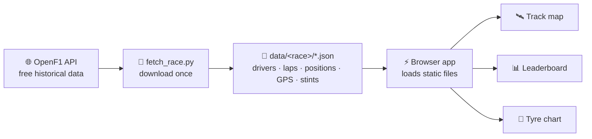

<div align="center">




<p>


</p>
<p>


</p>

**[🏎️ Watch a race replay](https://hemashreevi.github.io/pit-wall/)** · **[✨ Features](#-features)** · **[🧭 How it works](#-how-it-works)** · **[🗺️ Roadmap](#%EF%B8%8F-roadmap)**

</div>

---

## 🏁 What is Pit Wall?

Race engineers sit on the pit wall watching **every car's position, gap and tyre** at once. **Pit Wall brings that view to your browser.** Pick any race from 2023 onwards and watch it unfold from real GPS data, with every overtake, every undercut and every pit stop.

## ✨ Features

<table>
<tr>
<td width="50%" valign="top">

### 🛰️ Live track map
Every car is a glowing dot in its team colour, moving around the real circuit shape built from GPS data. Play, pause, scrub, or run at **1× to 10×** speed.

</td>
<td width="50%" valign="top">

### 📊 Animated leaderboard
Positions **slide and swap** on every overtake. Gaps to the leader tick in real time, and pit stops flash as they happen.

</td>
</tr>
<tr>
<td valign="top">

### 🛞 Tyre strategy chart
The whole field's stints at a glance (soft, medium, hard, intermediate and wet), with each pit lap marked.

</td>
<td valign="top">

### 🧑‍✈️ Driver cards
Click any driver for their headshot, team colour, fastest lap, positions gained or lost, and a lap-time chart.

</td>
</tr>
<tr>
<td valign="top">

### ⚔️ Head-to-head
Pick two drivers and compare their lap times and gap, lap by lap. Who really had the pace?

</td>
<td valign="top">

### 🎬 Cinematic intro
An animated race car streaks across the screen before the lights go out.

</td>
</tr>
</table>

## 🎬 Demo

> 🛠️ *A replay GIF and the live link go here once the track map is built.*

## 🧭 How it works



**Why pre-download?** The free OpenF1 tier allows about 30 requests a minute. Fetching a race once and saving it as files makes the demo **instant and reliable**, with no loading spinners and no rate-limit errors during a demo.

## ⚡ Run locally

No build step and no dependencies: just Python 3 and a browser.

```bash
git clone https://github.com/HemashreeVI/pit-wall-an-animated-race-replay.git
cd pit-wall-an-animated-race-replay

# start the app: a synthetic demo race is included, so it works straight away
python -m http.server 8000     # then open http://localhost:8000
```

Add real races from OpenF1 (each one is downloaded once and then shows up in the race picker):

```bash
python fetch_race.py --list 2024                     # see the season's races
python fetch_race.py --year 2024 --race "Monza"      # ~5 min, paced for the free tier
```

> 🧪 The bundled **Demo Grand Prix** (`data/demo/`) uses a fictional circuit, drivers and teams made by `generate_demo.py`, and the app labels it **DEMO DATA**. Run `python generate_demo.py --seed 7` to make a different one.

**Controls:** `Space` play/pause · `←` `→` seek 10 s (`Shift` for 60 s) · `1`–`5` speed (1×, 2×, 5×, 10×, 30×) · click a car or a leaderboard row for its driver card.

## 🗂️ Project structure

```
pit-wall/
├── fetch_race.py       # downloads one race from OpenF1 into data/
├── generate_demo.py    # makes the synthetic demo race (same format)
├── data/
│   ├── races.json      # index used by the race picker
│   └── <race>/         # meta, drivers, laps, positions, intervals,
│                       # stints, pits, track, locations, results (.json)
├── index.html          # the pit wall screen
├── css/style.css       # theme and animations
└── js/
    ├── data.js         # loads a race, answers "where was everyone at time t?"
    ├── replay.js       # the race clock: play, pause, seek, speed
    ├── trackmap.js     # draws the circuit and moving cars
    ├── leaderboard.js  # animated positions, gaps, tyres, pit flashes
    ├── tyres.js        # tyre strategy chart
    ├── charts.js       # driver cards and head-to-head charts
    ├── intro.js        # lights-out intro
    └── main.js         # wires it all together
```

## 🗺️ Roadmap

- [x] **Step 1:** Fetch one race and save it as JSON
- [x] **Step 2:** Draw the circuit from GPS points
- [x] **Step 3:** Moving cars and the replay controls
- [x] **Step 4:** Animated leaderboard with gaps
- [x] **Step 5:** Tyre strategy chart and driver cards
- [x] **Step 6:** Head-to-head mode and the intro animation
- [x] *Stretch:* race picker (lists every race you have downloaded)
- [ ] *Stretch:* one-click download of every 2023+ race, team-radio clips at key moments

## 🚀 Deploy to GitHub Pages

Everything is static. Commit the `data/` folders you want to show, then enable **Settings → Pages → Deploy from branch → `main` / root**.

## 🧰 Built with

<p align="center"></p>

## 🙏 Credits & disclaimer

- Race data from **[OpenF1](https://openf1.org)**, a free, open-source F1 data API.
- Driver headshots are loaded from the URLs provided by the API and remain the property of their owners.
- This is an **unofficial fan project** for learning and portfolio purposes. It is not associated with Formula 1, the FIA or any team. F1 and FORMULA 1 are trademarks of Formula One Licensing B.V.

---

<div align="center">

**Built by [Hemashree V I](https://hemashreevi.github.io)**, F1 fan and engineer 🏎️💨

<a href="https://hemashreevi.github.io"></a>
<a href="https://www.linkedin.com/in/hema-shree-373622289"></a>
<a href="mailto:shreejith2005@gmail.com"></a>

</div>
